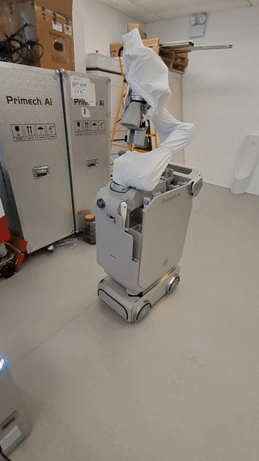
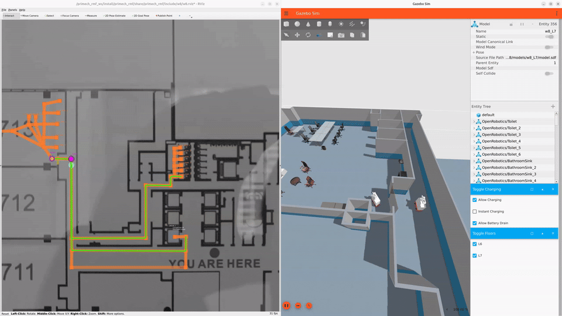
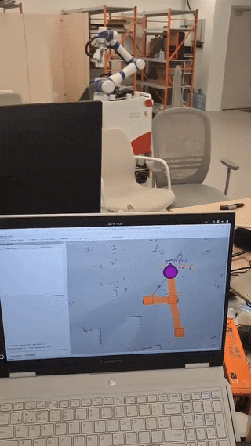

# 🚽 Toilet Cleaning Robot

Nobody wants to clean public toilets, so let a robot do it. **Hytron** is an autonomous toilet cleaning robot. It drives itself to a toilet, urinal or sink, lines up in front of it, and gets to work: spraying water, scrubbing with two different kinds of brushes, and also wiping the floor.

<!-- more -->

## 🤖 How It Works

Cleaning happens in three steps:

1. **Get close.** The robot uses 2D navigation to drive roughly to the goal location.
2. **Line up precisely.** A YOLO object detector finds the fixture, and two laser distance sensors fine-tune the robot's position in front of it.
3. **Clean.** The robot arm runs its cleaning routine: spray, brush, wipe.

Step 2 matters more than it looks. The arm motions are pre-recorded rather than adapting to the environment, so if the robot is parked a few centimeters off, the brush will press to hard on the surface or ever collide. Accurate docking is what makes everything after it work.

## 🛠️ Technology Stack

- [ROS/ROS2](https://wiki.ros.org/noetic) (Robot Operating System)
- C++, Python
- [SLAM, Navigation Stack](https://wiki.ros.org/navigation)
- [ros_control](https://wiki.ros.org/ros_control)
- [Gazebo Simulation](https://gazebosim.org/docs/all/getstarted/)
- [Open-RMF](https://github.com/open-rmf/rmf_demos)

## ⚡ The Challenge: Legacy Code

However the dirty job still needed to be done by myself, the codebase cleanup.

Despite being a robotics project, the legacy code barely used ROS. The depth camera driver was the only ROS2 node; everything else was a pure Python prototype. Here's what I was dealing with:

- **Magic numbers** everywhere, with no hint of where they came from
- **Variable names** like `v` and `p`, it gets better like `vv`. What's the difference between v and vv?
- **Business logic** as a hand-drafted state machine made of dozens of nested `if/else` statements

Just reading the code, I couldn't make sense of even the simplest function. AI to the rescue: it helped me work out what the code was actually doing. Without it, it would have taken months to just make a simple change.

From there I refactored step by step. Every part I touched became a **small, isolated ROS2 node** with one clear job. The book [Clean Code](https://www.lkhibra.ma/books/clean-code.pdf) was a great guide for untangling the spaghetti.

## 🙋 My Contributions

### ⚙️ Servo Motor Control

I connected the servo motors through [ros2 CANopen](https://ros-industrial.github.io/ros2_canopen/manual/rolling/), so they can be controlled through standard ROS2 interfaces.

### 🗺️ Fleet Management with Open-RMF

I built an Open-RMF bridge so the robot can be dispatched and monitored from a fleet management platform alongside other robots. Here it is in Gazebo simulation and in the Open-RMF dashboard:

### 👁️ Fixture Detection with YOLO

I trained a YOLO model to detect toilets, urinals and sinks. Its detections tell the robot where to dock in front of each fixture.

## 📚 Lessons Learned

- **Naming is not a detail.** After weeks of puzzling over `v` and `p`, I now pay extra attention to variable and function names. Code is read far more often than it's written.
- **Refactor in small pieces.** Turning one part at a time into an isolated ROS2 node kept the robot working while the codebase got better.
- **Everything needs unittest** I started setting up automated testing on the gitlab server for each codebase I touched. That made me more confident on making bigger and bigger edits.
